

*Monitor. Detect. Investigate. Analyse.*

---

## 01 / Project Overview

A Security Information and Event Management (SIEM) academic project developed using the ELK Stack to perform centralized log analysis, security monitoring, anomaly detection and threat investigation.

The project involved indexing approximately 5,000 network log records and developing an interactive Kibana dashboard consisting of 11 visualization panels.

| Information | Details |
| --- | --- |
| Project Type | Academic Project |
| Year | 2025 |
| Domain | Cybersecurity & Security Operations |
| Log Records | Approximately 5,000 |
| Dashboard Panels | 11 |
| Status | Completed |

## 02 / Project Objectives

- Implement a local SIEM environment.
- Perform centralized network log analysis.
- Develop security monitoring dashboards.
- Identify suspicious network activity.
- Investigate potential security incidents.
- Perform IP reputation analysis using threat intelligence.

## 03 / System Architecture

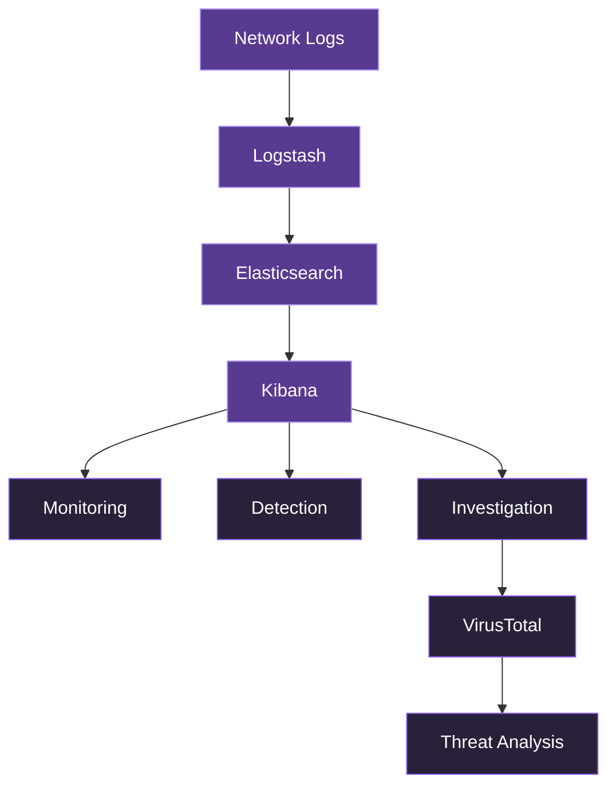

The architecture illustrates the logical workflow of log processing, visualization and security investigation.

## 04 / Tools & Technologies

| Technology | Purpose |
| --- | --- |
| Elasticsearch | Log indexing, storage and searching |
| Logstash | Log ingestion and processing |
| Kibana | Data visualization and security monitoring |
| Kibana Discover | Detailed log investigation |
| VirusTotal | Threat intelligence and IP reputation analysis |

## 05 / Network Log Analysis

The network log dataset contained security-related information, including:

- Timestamp
- Source IP address
- Destination port
- Network protocol
- Country
- Service
- Action

These fields were used to investigate network activity and identify potentially suspicious behaviour.

## 06 / Dashboard Engineering

Developed an interactive Kibana dashboard consisting of 11 visualization panels.

The dashboard included:

- Pie charts
- Bar charts
- Metric displays
- Data tables
- Geographic maps

### Security Monitoring Coverage

| Monitoring Area | Purpose |
| --- | --- |
| Login Results | Analyse successful and failed login activity |
| Failed Login Attempts | Identify potential brute-force activity |
| Access by Country | Examine geographic access patterns |
| Destination Ports | Identify frequently targeted ports |
| Network Services | Monitor accessed services |
| Network Protocols | Examine protocol usage |
| Blocked Access | Investigate denied network activity |
| Repeated Port Access | Identify potential scanning behaviour |

### Kibana Security Monitoring Dashboard

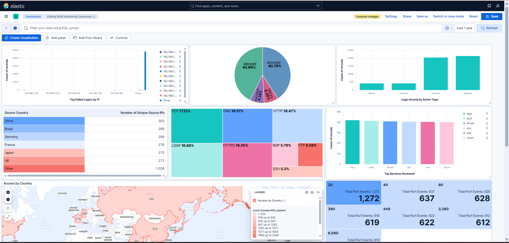

*Figure 1: Overview of the Kibana security monitoring dashboard.*

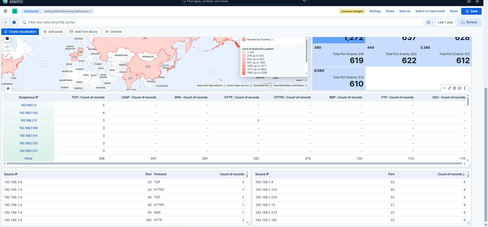

*Figure 2: Additional network security monitoring visualizations.*

## 07 / Security Monitoring

The monitoring phase focused on observing network activity and identifying abnormal patterns through dashboard visualizations.

Activities included:

- Monitoring successful and failed login attempts.
- Identifying frequently accessed network services.
- Analysing network protocol distribution.
- Monitoring blocked access attempts.
- Identifying repeated activity from specific IP addresses.
- Examining geographic access patterns.

### Geographic Access Monitoring

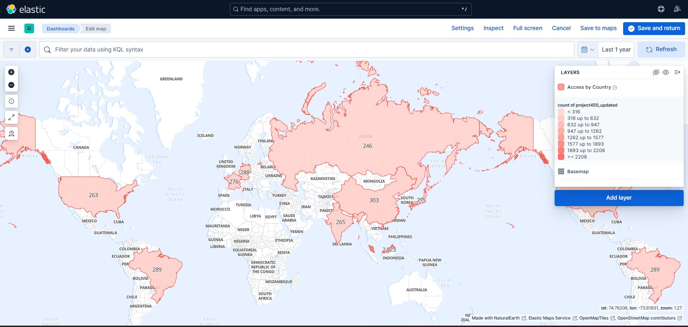

*Figure 3: Geographic distribution of network access.*

### Destination Port Analysis

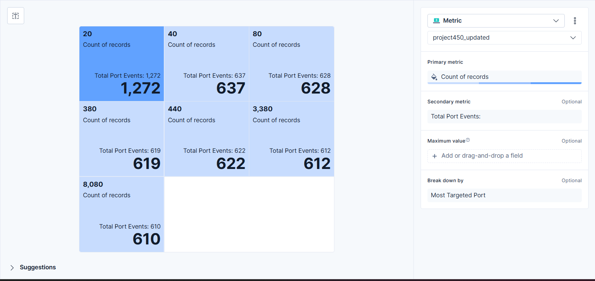

*Figure 4: Analysis of frequently accessed destination ports.*

## 08 / Threat Detection

Potential security threats were investigated based on observable behaviour within the dataset.

| Potential Threat | Detection Indicator |
| --- | --- |
| Brute-force Attack | Repeated failed login attempts |
| Port Scanning | Repeated or unusual destination port activity |
| Suspicious Access | Abnormal network access patterns |
| Protocol Anomaly | Unexpected protocol and port combinations |
| Unauthorized Access | Repeated blocked access attempts |

These indicators were used to identify events requiring further investigation rather than automatically classifying them as confirmed attacks.

### Failed Login Attempts

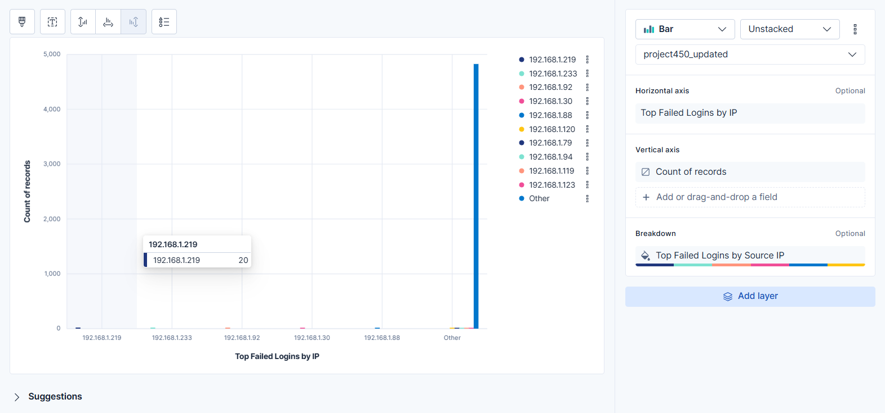

*Figure 5: Failed login activity used to investigate potential brute-force attempts.*

### Blocked Access Monitoring

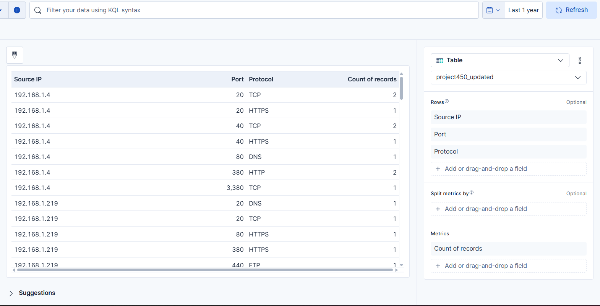

*Figure 6: Monitoring blocked network access attempts.*

### Repeated Port Access

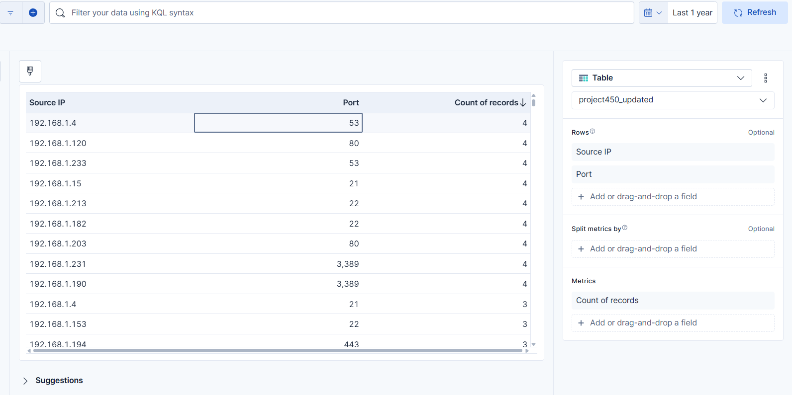

*Figure 7: Repeated port access activity investigated for potential scanning behaviour.*

## 09 / Security Investigation

### Phase 1 — Kibana Discover

- Identified suspicious IP addresses through the dashboard.
- Filtered network logs by source IP.
- Examined event timestamps.
- Analysed destination ports and protocols.
- Investigated accessed services.
- Reviewed allowed and blocked actions.

### Phase 2 — Threat Intelligence

VirusTotal was used to perform external IP reputation checks and support the investigation process.

### Example Investigation

| Investigation Field | Observation |
| --- | --- |
| Destination Port | 80 |
| Protocol | DNS |
| Service | DNS |
| Action | Blocked |
| VirusTotal Result | No vendors flagged the IP as malicious |

The protocol and port combination was identified as an anomaly requiring further analysis.

The absence of malicious reputation findings did not independently establish that the activity was benign.

### Kibana Discover Investigation

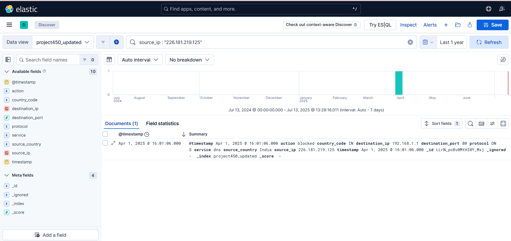

*Figure 8: Detailed investigation of network log records using Kibana Discover.*

### VirusTotal Threat Intelligence

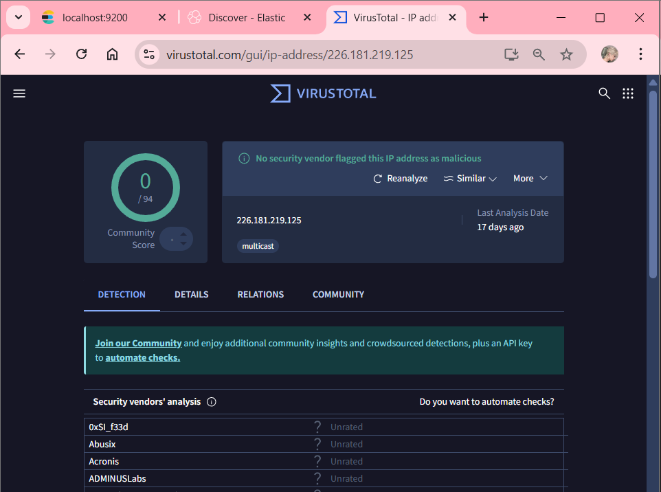

*Figure 9: IP reputation investigation using VirusTotal.*

## 10 / Investigation Workflow

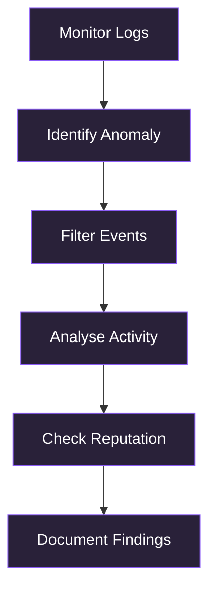

## 11 / Project Outcomes

- Indexed approximately 5,000 network log records.
- Developed 11 security visualization panels.
- Investigated potentially suspicious network activity.
- Analysed indicators associated with brute-force and port-scanning behaviour.
- Performed detailed log investigations using Kibana Discover.
- Integrated external IP reputation analysis into the investigation workflow.

## 12 / Technical Skills Developed

- Security Information and Event Management (SIEM)
- Security Operations Centre (SOC) fundamentals
- Security event monitoring
- Network log analysis
- Threat detection
- Threat intelligence
- Incident investigation
- Data visualization
- Network traffic analysis
- Security dashboard development

## 13 / Future Improvements

- [ ] Real-time log ingestion
- [ ] Automated security alerting
- [ ] Windows and Linux endpoint monitoring
- [ ] MITRE ATT&CK mapping
- [ ] Automated threat intelligence enrichment
- [ ] Custom detection rules
- [ ] Integration with cybersecurity home lab

## 14 / Disclaimer

This project was developed for academic and educational purposes within a controlled learning environment.

---

*Explore. Learn. Secure. Repeat.*

[GitHub Profile](https://github.com/rosinss)

